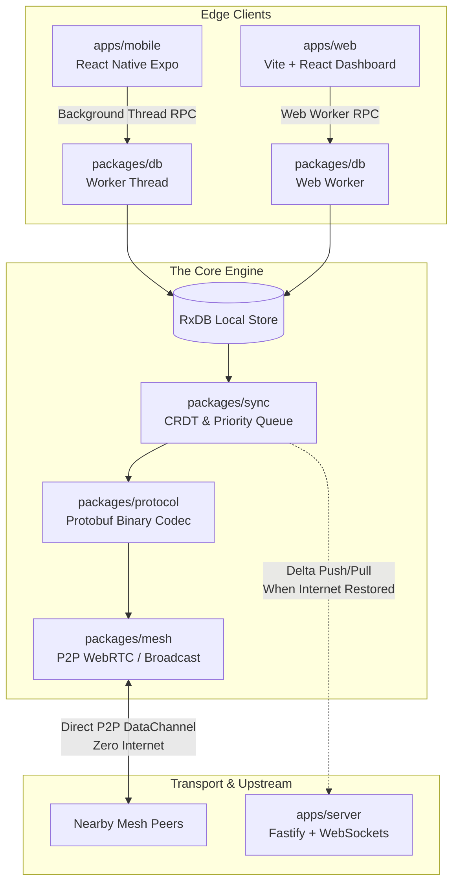

# BLACKOUT ⚡📡

> **Offline-First, Zero-Internet P2P Mesh Emergency Incident Reporting & Response System**

Blackout is engineered for extreme disaster conditions—earthquakes, hurricanes, infrastructure collapses, and grid blackouts. When cellular networks fail and internet service is severed, Blackout creates a peer-to-peer device mesh over local WebRTC, WiFi Direct, and BLE to synchronize life-critical emergency reports with zero external dependencies.

---

## 🏗️ Architecture Overview



---

## 📦 Monorepo Structure

```
blackout/
├── apps/
│   ├── mobile/                 # React Native (Expo) Field Responder App
│   │   ├── src/
│   │   │   ├── components/     # SeveritySelector, IncidentCard
│   │   │   ├── screens/        # IncidentFeedScreen, NewReportScreen, MeshRadarScreen
│   │   │   └── workers/        # Native worker threads for background DB offload
│   │   └── app.json
│   ├── web/                    # Vite + React Command Center Dashboard
│   │   ├── src/
│   │   │   ├── components/     # Header, ReportCard, PeerRadar
│   │   │   ├── pages/          # Dashboard, CreateReportModal
│   │   │   └── workers/        # Dedicated Web Worker running RxDB
│   │   └── vite.config.ts
│   └── server/                 # Fastify Backend & Gateway
│       ├── src/
│       │   ├── routes/         # REST & WebSocket live streaming endpoints
│       │   ├── db/             # Server database abstraction (Postgres/Redis)
│       │   └── sync/           # Server-side CRDT conflict resolution
│       └── server.ts
├── packages/                   # Shared Core Engine ("The Secret Sauce")
│   ├── db/                     # LOCAL DATABASE LAYER
│   │   ├── src/
│   │   │   ├── schema.ts       # RxDB reactive JSON schemas (Reports, Users)
│   │   │   ├── collections.ts  # Typed repository & reactive observables
│   │   │   └── worker.ts       # Main-thread RPC bridge to background workers
│   │   └── package.json
│   ├── sync/                   # SYNC & CONFLICT ENGINE
│   │   ├── src/
│   │   │   ├── replication.ts  # Binary replication protocol & stage/flush engine
│   │   │   ├── priority-queue.ts # Severity-weighted outbox (CRITICAL first)
│   │   │   └── crdt.ts         # Vector Clocks & deterministic LWW resolution
│   │   └── package.json
│   ├── mesh/                   # LOCAL P2P MESH (NO INTERNET)
│   │   ├── src/
│   │   │   ├── discovery.ts    # WebRTC / Broadcast peer beacons & presence
│   │   │   └── peer-sync.ts    # Direct device-to-device delta synchronization
│   │   └── package.json
│   ├── protocol/               # BINARY SERIALIZATION (Low Latency)
│   │   ├── src/
│   │   │   ├── schema.proto    # Protobuf definitions for Reports & Packets
│   │   │   └── codec.ts        # Ultra-fast binary encoder/decoder
│   │   └── package.json
│   ├── ui/                     # Shared Tactical Dark UI (Badges, Theme, Indicators)
│   └── types/                  # Shared TypeScript Domain Interfaces
├── turbo.json                  # Turborepo build pipeline
├── pnpm-workspace.yaml         # pnpm workspace definition
└── package.json                # Root package configuration
```

---

## ⚡ The "Secret Sauce"

1. **Background Worker DB Offload (`packages/db`)**
   - RxDB is executed inside a dedicated **Web Worker** (Web) or **Worker Thread** (React Native).
   - Keeps UI animations at a silky 60 FPS even when processing thousands of incoming sync packets.
   - Clean RPC bridge (`DatabaseWorkerBridge`) for async queries and reactive observables.

2. **Severity-Weighted Priority Outbox (`packages/sync`)**
   - Transmissions across constrained mesh networks sort the outbox queue by severity score:
     - `CRITICAL` (Score 10,000)
     - `HIGH` (Score 5,000)
     - `MEDIUM` (Score 1,000)
     - `LOW` (Score 100)
   - Guarantees life-saving emergency medical/evacuation reports transmit ahead of low-priority traffic.

3. **Partition-Tolerant CRDTs & Vector Clocks (`packages/sync`)**
   - Distributed nodes generate concurrent edits in partitioned zones.
   - Vector Clocks determine causal dominance.
   - Concurrent conflicts resolve deterministically via Last-Write-Wins with lexicographical tiebreaking.
   - Casualty counts and resource needs automatically preserve safety maxima across merged branches.

4. **Zero-Internet P2P Mesh (`packages/mesh`)**
   - Automatically beacons presence via WebRTC DataChannels and local broadcast transport.
   - Dynamic peer radar visualizes nearby nodes in radio range.
   - Direct device-to-device delta replication without cloud access.

5. **Compact Binary Serialization (`packages/protocol`)**
   - Protobuf v3 definitions and lightweight binary packing minimize byte overhead for radio / high packet-loss links.

---

## 🚀 Quick Start

### 1. Install Dependencies
```bash
pnpm install
```

### 2. Start the Fastify Backend
```bash
pnpm --filter @blackout/server dev
```
Server runs on `http://localhost:4000` with REST (`/api/reports`, `/api/sync/pull`, `/api/sync/push`) and live WebSocket streams (`/api/reports/live`).

### 3. Launch the Web Command Center
```bash
pnpm --filter @blackout/web dev
```
Dashboard runs on `http://localhost:5173`. Open multiple tabs or browsers on the same network to see live P2P mesh discovery and real-time syncing!

### 4. Launch the Mobile Field Responder App
```bash
pnpm --filter @blackout/mobile start
```
Starts Expo development server for iOS, Android, or Web emulation.

### 5. Run Across Entire Monorepo
```bash
# Build all apps & packages
pnpm build

# Run type checking across all workspaces
pnpm type-check
```
